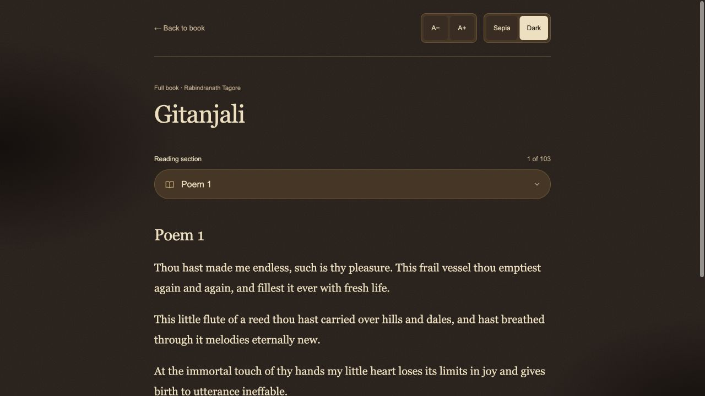
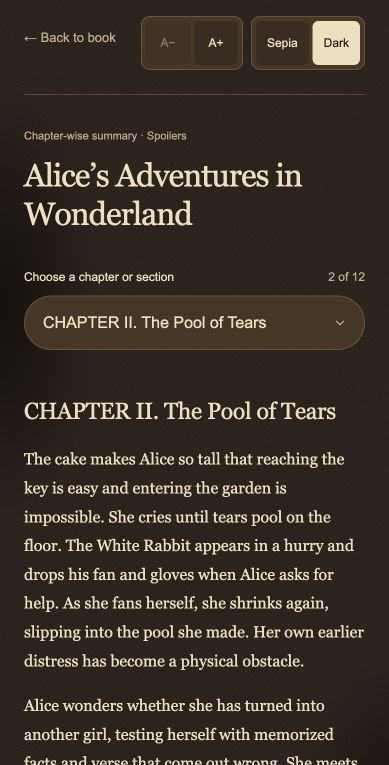

<div align="center">


# Bookstride

### A reading room worth returning to.

Find a book. Understand its ideas. Keep your place.

[**Open Bookstride ↗**](https://bookstride-rudraunsh.onrender.com/) · [Explore the collection](COLLECTION.md) · [Run it locally](#run-it-locally)

</div>

---

Bookstride brings book discovery, original summaries, practical lessons, and a personal shelf into a quiet reading space. Its warm palette, parchment backgrounds, and library-inspired shelves take their cues from a Mughal reading room. Inside a book, the design makes room for the text.

Created by **Rudraunsh Jadhav**, from the first interface to the reading experience and live deployment.

## A closer look

<table>
<tr>
<td width="62%" valign="top">

<p><strong>Space for the words.</strong> A focused reader with adjustable text and section navigation.</p>
</td>
<td width="38%" valign="top">

<p><strong>A closer reading.</strong> Chapter-wise guides are rolling out in the live app.</p>
</td>
</tr>
</table>

*Screenshots show the hosted reading experience. The chapter-summary screenshot shows a live-app feature added after this public source snapshot.*

## What you can do

- **Find your next book.** Search by title or author, or explore the collection by genre.
- **Read with context.** Open an original summary and consider the book's themes through practical lessons. Summaries include spoilers.
- **Build MyShelf.** Save titles you want to return to and remove them when your plans change.
- **Choose how you read.** Adjust text size and switch between dark brown and sepia.
- **Continue where you stopped.** The live app remembers your reading section in the same browser.
- **Take the reading room with you.** Install the live app from a supported browser. Selected in-app editions can be saved for offline reading.

## The live app and this repository

| | Live Bookstride | This public source snapshot |
| --- | --- | --- |
| Collection | 62 titles across 15 genres | 55 titles across 11 genres |
| Summaries and lessons | 62 book guides | 55 guides and 177 lessons |
| Chapter-wise summaries | Available for 9 titles; more in progress | Added after this snapshot |
| Full editions | 12 selected titles readable inside the app; other titles link to their sources or publishers | Full-text links open source catalogues |
| Personal shelf | Saved in the current browser | Saved in the current browser |
| Hosting | Published on Render | Run locally using the instructions below |

**Try the latest experience at [bookstride-rudraunsh.onrender.com](https://bookstride-rudraunsh.onrender.com/).** This repository shares a browsable source snapshot. The hosted release is maintained separately.

Shelves, preferences, and reading positions are saved on the device and browser being used. Account sync and automatic server backup are planned work.

## Run it locally

You need **Python 3**, a browser, and a copy of this repository.

1. Clone the repository, then enter its folder.

   ```sh
   git clone https://github.com/Rudraunsh11/bookstride-web.git
   cd bookstride-web
   ```

2. Start the local server.

   ```sh
   python3 -m http.server 8790 --bind 127.0.0.1 --directory site
   ```

3. Open **http://127.0.0.1:8790/** in your browser.

Press **Ctrl+C** in the terminal to stop the server. You can also download the repository ZIP from GitHub's **Code** menu, extract it, and run the server command from that folder.

## Built with

**HTML · CSS · JavaScript · Web App Manifest · Service Worker**

The interface uses browser APIs for preferences, shelf storage, and installation. The live deployment is served as a static site on Render.

## Where to look

| Path | What it contains |
| --- | --- |
| `site/` | The runnable public website snapshot |
| `site/app.js` | Discovery, shelf, and reading-interface behavior |
| `site/style.css` | Responsive layouts, themes, and visual details |
| `site/catalog*.js` | Book records, original guides, and lessons |
| [COLLECTION.md](COLLECTION.md) | Titles, authors, and source-edition links |
| [LICENSE](LICENSE) and [NOTICE.md](NOTICE.md) | Reuse terms and rights information |

## Next chapters

- Complete the remaining chapter-wise guides and review their depth and accuracy.
- Make releases and the public source easier to keep aligned.
- Test installation, accessibility, and offline reading on physical iPhone and Android devices.
- Develop optional shelf sync and account recovery.

These items are in progress. The public snapshot and hosted app currently have the differences listed above.

## Feedback

Found a broken link or a reading problem? [Open an issue](https://github.com/Rudraunsh11/bookstride-web/issues/new) with the book title, what happened, your browser, and your device. A screenshot can help. For a suspected security issue, contact the developer privately and omit sensitive details from public issues.

## License and credits

Original application code, styles, and technical documentation are available under the **MIT License**, with the copyright and license notice retained. The repository's existing rights notice separately reserves the original guides, lessons, Bookstride name, artwork, and logos. Source editions carry their own terms. Read [LICENSE](LICENSE) and [NOTICE.md](NOTICE.md) before reusing material.

---

<div align="center">

**Built by Rudraunsh Jadhav**

[GitHub](https://github.com/Rudraunsh11) · [Email](mailto:rudraunshjadhav@gmail.com) · [Read on Bookstride](https://bookstride-rudraunsh.onrender.com/)

© 2026 Rudraunsh Jadhav

</div>
